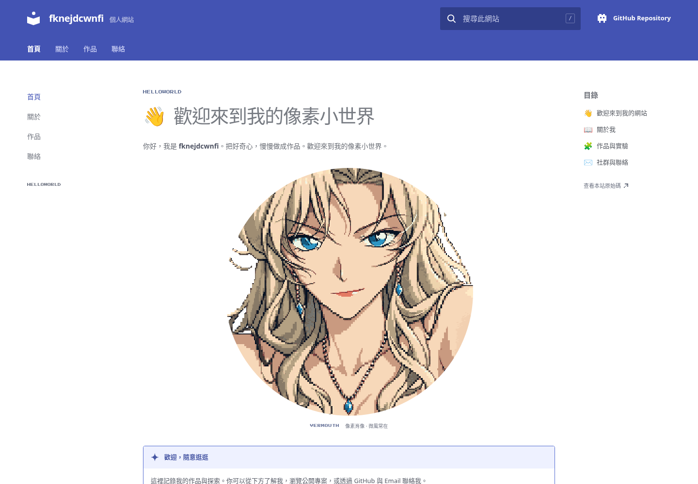

# fknejdcwnfi · 我的像素小世界

**HELLOWORLD**。一個白底、靛藍雙層導航與文件式三欄的個人網站，包含站內搜尋、個人介紹、真實作品、聯絡方式，以及居中無框圓形、持續隨微風飄動並偶爾眨眼的 Minecraft-inspired 二維 Vermouth 像素近景。

- 網站：<https://fknejdcwnfi.github.io/website/>
- GitHub：<https://github.com/fknejdcwnfi> · Email：**fknejdcwnfi@gmail.com**
- 文件入口：[開發與個人化指南](docs/README.md)

保留同一張原近景角色、256²像素格與透明輪廓。八組髮束由根部錨定／末端自由的十七站耦合阻尼鏈響應風場，眨眼使用獨立時鐘，左右耳環各自響應；反向採樣的候選行依保守位移上界快取，減少每幀重複掃描。人物以無邊框圓形置於中軸，按DPR對齊整數實體像素。頁面與角色分離，後續真實帳號與遊戲資料可從獨立設定擴充。

最新實作、驗收及效能對照見[參考版面與物理重構](docs/guides/reference-rebuild.md)。本輪證據位於 `artifacts/reference-rebuild/`，先前 `flowing-hair` 與其他目錄保留作歷史。



[完整桌機](artifacts/reference-rebuild/site/desktop.png) · [手機](artifacts/reference-rebuild/site/mobile.png) · [無JavaScript](artifacts/reference-rebuild/site/no-javascript.png)

## 開始開發

使用 `.nvmrc` 指定的 Node24：

```bash
npm ci
npm run dev
```

開發網址為 `/`；`npm run build` 後用 `npm run preview` 檢查 `/website/`。送出前執行：

```bash
npm test
npm run typecheck
npm run build
npm run assets:check
npm run assets:verify
```

任務PR通過檢查後自動合併至 `main`，GitHub Actions負責Pages發佈；擁有者已授權自動更新。`npm run deploy`保留為明確要求時的手動備援，不用它跳過PR流程。

## 改成我的內容

只需先編輯 [site.ts](src/features/profile/content/site.ts)，角色動畫與個人資料互相獨立：

```ts
name: 'fknejdcwnfi',
intro: 'HELLOWORLD',
email: 'fknejdcwnfi@gmail.com',
socials: [],       // 填入你已確認的公開B站／抖音等帳號
gameProfiles: [], // 填入你願意公開的王者荣耀／火影忍者等資料
```

`socials`支援平台、名稱、HTTPS公開網址及可選暱稱；`gameProfiles`支援遊戲、公開暱稱／ID、區服、說明及可選HTTPS連結。沒有資料時不顯示空卡片、遊戲導覽或無效按鈕。需要新增時，參考 [site.example.ts](src/features/profile/content/site.example.ts) 的四個型別工廠與[完整欄位說明](docs/guides/personal-site.md#帳號與遊戲擴充)，填入自己的真實資料；範例檔不由網站載入。

作品只列真實公開repo，`xiangqi-review`如實標為封存。聯絡使用Email／GitHub及設定完成的社群，不使用假送信表單。Press Start 2P字體自託管，附[SIL OFL](public/fonts/OFL.txt)，中文使用系統字體。

## 目錄

```text
src/
  app/                 頁面組合、全站錯誤邊界與基礎樣式
  features/
    profile/           個人內容、網站版面、靜態HTML與像素UI
    portrait/          動畫、renderer與角色元件
  shared/              共用動畫型別
  archive/             僅明確歷史模式才載入的legacy／voxel
scripts/
  assets/              素材匯出與來源驗證
  qa/                  真實網站截幀、瀏覽器與效能檢查
  tests/               Node單元測試
  deploy/              手動部署備援
docs/
  guides/              現行個人化、角色、動態、開發及素材指南
  archive/             已標示日期的舊階段文件
  reference/           原始委託與分鏡，凍結唯讀
  decisions.md         決策歷史
archive/runtime/       保留但不隨網站打包的舊runtime素材
archive/evidence/      原v2／v4／v5量測與影像歷史
```

`SiteShell`提供共享版面與內容插槽；未來真實功能可組合新區塊並更新靜態HTML，不需要修改髮束rig。詳細路徑見[開發指南](docs/guides/development.md)。

## 動態與驗證

正常首頁在可見時持續緩慢微風，風週期12秒；眨眼使用獨立24秒時鐘，三次事件相隔6.9–9秒，每次280 ms。沒有舊輪末靜止段或公開播放／暫停按鈕；減少動態、隱藏／離屏仍停止繪製並保留相位。`?view=portrait&debug=1`開啟調試，`?t=4510`／`?pose=5`可固定閉眼，`?pose=1`／`?pose=10`保留同一canonical靜止畫面。初始HTML、透明poster、12秒素材逾時與錯誤邊界保留無JS／故障時的完整網站，展示同樣圓形居中。

本輪驗證與production同環境效能對照集中於[重構指南](docs/guides/reference-rebuild.md)及 `artifacts/reference-rebuild/`；先前數字保留在[PR #8可見風動基線](docs/guides/reference-wind.md)。測試包含完整頁面、搜尋／目錄／鍵盤、無JavaScript與故障備援，以及原始Canvas的固定區、髮根、色盤、alpha、接縫、多Hz同時刻與可見中段風動。

實際更新率受顯示器、瀏覽器排程與裝置能力限制；Canvas取樣、GIF編碼率、解除排程上限的吞吐及模擬240 Hz都不等於實體螢幕FPS。這是有界二維彈簧變形，並非完整三維毛髮或流體模擬。證據不隨網站runtime下載。

## 素材

`assets/source/**`及`docs/reference/**`保持唯讀。原始參考是身份與近景構圖的最高權威；canonical母版仍在 `assets/generated/portrait-v4/`，局部髮後修復在 `assets/generated/portrait-wind/`，runtime為 `public/assets/portrait-natural/`。不輪播新生成的臉、不整張圖晃動，也不擴圖成完整胸像。[素材清冊](docs/guides/asset-inventory.md)記錄來源及限制。

貝爾摩德出自《名偵探柯南》，角色權利屬原權利方，本專案為個人非商業粉絲作品。Minecraft為相關權利方商標，本站不是官方合作產品。見[變更紀錄](CHANGELOG.md)。
