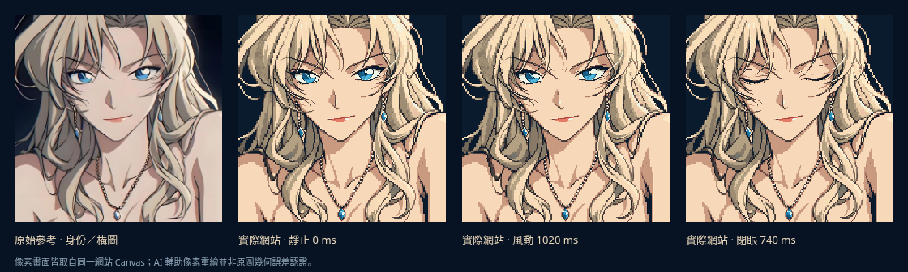

# Vermouth · Pixel Art Living Portrait

以原始貝爾摩德近景為基準的 **Minecraft-inspired 高精緻2D像素動態立繪**：保留尖下巴、冰藍斜眼、自信微笑、偏分金色捲髮、修長藍耳墜與低位吊墜。這次方向以角色還原為首要目標，不採Steve方頭方身或3D voxel造型。

- **網站**：<https://fknejdcwnfi.github.io/website/>
- **現行契約**：[11 Living Portrait](docs/11-living-portrait.md)，決策見 [ADR-015](docs/08-decisions.md#adr-015--以忠實-2d-像素立繪取代方頭-voxel-預設)
- **技術**：Vite、React、TypeScript與Native Canvas2D；美術資產、局部rig與時間軸分離
- **歷史比較**：`?style=voxel`保留前次方塊胸像，`?style=legacy`保留原動漫十幀預覽；都不是目前目標

正式頁面只展示單一1:1角色與深色背景，不新增導航、自介、卡片、登入或其他功能。原始參考最高優先；十張動作圖不逐張像素化輪播。canonical像素畫為AI輔助風格轉譯，閉眼材料只用於局部眼區，不在動畫中換臉。



[實際網站動畫預覽](artifacts/animation_preview.gif) · [桌機](artifacts/desktop.png) · [手機](artifacts/mobile.png)

## 開發與驗證

使用 `.nvmrc` 指定的 Node24，沿用既有雲端checkout：

```bash
npm ci
npm run dev
npm test
npm run typecheck
npm run build
npm run assets:check
npm run assets:verify
```

`prebuild`先跑測試，既有CI與Pages build沿用。production預覽用 `npm run preview`，base為`/website/`；dev base為`/`。日常更新經PR，必要驗證與CI通過後自動合併，再確認該提交的Pages部署；不使用會force-push `gh-pages` 的手動fallback。

## 動態與調試

預設256²統一像素網格、nearest-neighbor放大；192／256／320可比較精細度。2300 ms循環依參考錨點設計風起、風峰、回彈與回落，1890 ms回靜止。髮區以根部固定的有界局部取樣變形；眼瞼獨立完成630–850 ms眨眼，耳環下段輕擺、項鏈固定。固定臉、身體與未知遮擋區不跟隨全圖晃動。

系統減少動態、固定姿態與暫停均停止角色更新；隱藏分頁暫停、恢復後續播。正式畫面沒有控制項，`?debug=1`才顯示風力、方向、陣風、剛度、阻尼、速度、手動眨眼與暫停控制。

```text
?debug=1
?pose=5
?t=740
?pixel=320&wind=0.6&speed=0.75
?style=voxel
?style=legacy&pose=5
```

完整選項、防呆、時間語義、素材與證據要求見 [現行契約](docs/11-living-portrait.md)。品質驗證應同時看原圖對照、十個真實網站截幀與連續動畫，不以編譯成功或單張AI候選圖代替。

## 可重跑的素材與瀏覽器檢查

在另一個終端啟動Vite後，可執行下列指令；Python環境需具備Playwright、Chromium與Pillow。素材匯出及功能探針使用dev server；截幀亦可將網址改為production preview的`/website/`。

```bash
python3 scripts/export_portrait.py --url http://127.0.0.1:5173/
python3 scripts/verify_portrait_browser.py --url http://127.0.0.1:5173/
python3 scripts/capture_portrait.py --url http://127.0.0.1:5173/
```

目前24項單元測試與33項瀏覽器功能檢查通過，包括真實播放器以60／120 Hz模擬步進時得到相同相位與像素。像素比對確認35,998個受保護像素在風動時不變，八組髮區與耳墜均有變化；閉眼變化僅在眼區，0／1890／2300 ms畫面一致。結果見 [QA紀錄](artifacts/qa.json) 與 [截幀紀錄](artifacts/capture.json)。GIF以67個時間點取樣，編碼總長2300 ms；它是實際網站的時間軸截幀，不能當作即時FPS測量。

獨立production單頁的5秒headless容器抽樣為300次繪製、60.0 fps，rAF callback CPU中位數0.7 ms／p95 1.0 ms，無長任務；只載入兩張runtime材料、共107,636 bytes。條件與結果見 [效能紀錄](artifacts/performance.json)，不代表所有實體手機表現。可在build及啟動preview後重跑 `python3 scripts/measure_portrait.py --url http://127.0.0.1:4173/website/`。

## 素材與限制

`assets/source/**`及`docs/reference/**`保持唯讀；目前最高身份基準是 `assets/source/original_reference.jpg`。生成母版位於`assets/generated/portrait-v2/`，網站角色／眼瞼材料位於`public/assets/portrait/`；來源、方法與限制見 [素材清冊](docs/02-asset-inventory.md)。未知肩頸／臉側後方沒有可信clean plate時，縮小或凍結該區動作，不宣稱已完成所有原圖分層。

這是受參考約束的像素美術轉譯，不宣稱原圖幾何已逐像素1:1量測一致、所有裝置達60fps，或主觀品質已「完美」。真實驗證結果與剩餘限制應依實測更新；前次voxel的效能紀錄不移作新版證據。

貝爾摩德出自《名偵探柯南》，角色權利屬原權利方；本專案為個人非商業粉絲作品。Minecraft為相關權利方商標，本站不是官方合作產品。詳見 [文件導覽](docs/README.md) 與 [變更紀錄](CHANGELOG.md)。
