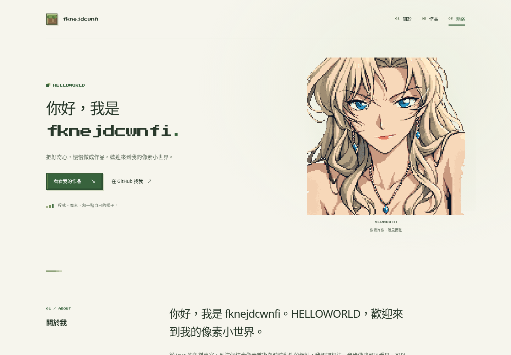

# fknejdcwnfi · 我的像素小世界

**HELLOWORLD**。一個 Minecraft 像素風個人網站，包含個人介紹、真實作品、聯絡方式，以及透明無框、會隨風動與眨眼的 Vermouth 近景肖像。

- 網站：<https://fknejdcwnfi.github.io/website/>
- GitHub：<https://github.com/fknejdcwnfi> · Email：**fknejdcwnfi@gmail.com**
- 文件入口：[開發與個人化指南](docs/README.md)

保留同一張原近景角色、256²像素格與透明輪廓；八組髮束分段延遲，配合局部眼瞼、左右耳環及髮後修復。整站以草地方塊色帶、像素邊界、物品欄式作品區與清楚的中文排版構成，後續帳號與遊戲資料有獨立設定入口。



[完整桌機](artifacts/personal-site/desktop.png) · [手機](artifacts/personal-site/mobile.png) · [無JavaScript](artifacts/personal-site/no-javascript.png)

[角色動態](artifacts/pixel-world/animation_preview.gif) · [首頁動態](artifacts/pixel-world/website_motion.gif) · [144張實際截幀](artifacts/pixel-world/contact_sheet_144.png) · [完整276時刻圖集](artifacts/pixel-world/gallery.html) · [原圖／風動／眨眼對照](artifacts/pixel-world/comparison.png)

## 開始開發

使用 `.nvmrc` 指定的 Node24：

```bash
npm ci
npm run dev
```

開發網址為 `/`；`npm run build` 後用 `npm run preview` 檢查 `/website/`。送出前執行：

```bash
npm test
npm run typecheck
npm run build
npm run assets:check
npm run assets:verify
```

任務PR通過檢查後自動合併至 `main`，GitHub Actions負責Pages發佈；擁有者已授權自動更新。`npm run deploy`保留為明確要求時的手動備援，不用它跳過PR流程。

## 改成我的內容

只需先編輯 [site.ts](src/features/profile/content/site.ts)，角色動畫與個人資料互相獨立：

```ts
name: 'fknejdcwnfi',
intro: 'HELLOWORLD',
email: 'fknejdcwnfi@gmail.com',
socials: [],       // 填入你已確認的公開B站／抖音等帳號
gameProfiles: [], // 填入你願意公開的王者荣耀／火影忍者等資料
```

`socials`支援平台、名稱、HTTPS公開網址及可選暱稱；`gameProfiles`支援遊戲、公開暱稱／ID、區服、說明及可選HTTPS連結。沒有資料時不顯示空卡片、遊戲導覽或無效按鈕。需要新增時，參考 [site.example.ts](src/features/profile/content/site.example.ts) 的四個型別工廠與[完整欄位說明](docs/guides/personal-site.md#帳號與遊戲擴充)，填入自己的真實資料；範例檔不由網站載入。

作品只列真實公開repo，`xiangqi-review`如實標為封存。聯絡使用Email／GitHub及設定完成的社群，不使用假送信表單。Press Start 2P字體自託管，附[SIL OFL](public/fonts/OFL.txt)，中文使用系統字體。

## 目錄

```text
src/
  app/                 頁面組合、全站錯誤邊界與基礎樣式
  features/
    profile/           個人內容、網站版面、靜態HTML與像素UI
    portrait/          動畫、renderer與角色元件
  shared/              共用動畫型別
  archive/             僅明確歷史模式才載入的legacy／voxel
scripts/
  assets/              素材匯出與來源驗證
  qa/                  真實網站截幀、瀏覽器與效能檢查
  tests/               Node單元測試
  deploy/              手動部署備援
docs/
  guides/              現行個人化、角色、動態、開發及素材指南
  archive/             已標示日期的舊階段文件
  reference/           原始委託與分鏡，凍結唯讀
  decisions.md         決策歷史
archive/runtime/       保留但不隨網站打包的舊runtime素材
archive/evidence/      原v2／v4／v5量測與影像歷史
```

`SiteShell`提供共享版面與內容插槽；未來真實功能可組合新區塊並更新靜態HTML，不需要修改髮束rig。詳細路徑見[開發指南](docs/guides/development.md)。

## 動態與驗證

正常首頁在可見時持續重播2300 ms，沒有公開播放／暫停按鈕；尊重減少動態，隱藏／離屏停止繪製並保留相位。`?view=portrait&debug=1`開啟完整調試，`?t=740`／`?pose=5`可固定眨眼畫面。初始HTML、透明靜態poster、12秒素材逾時與錯誤邊界保留無JS／故障時的完整網站。

本輪37項單元、型別與production build通過；[角色51項QA](artifacts/pixel-world/qa.json)及[完整網站41項QA](artifacts/personal-site/checks.json)通過。27,519個保護像素與160個髮根零改變，眨眼只改眼區，風動與修復可見；60／120／144／240 Hz模擬跨輪相位及像素一致。更密的實際網站截幀與原生效能結果集中於 `artifacts/pixel-world/`，量測方法及前版歷史資料見[參考風動](docs/guides/reference-wind.md)。實際更新率受顯示器、瀏覽器排程與裝置能力限制；確定性取樣及模擬240 Hz不當作實際顯示器FPS。

已擷取276個均勻時間點、十個明確姿態及十個連續錨點，按內容去重為205張真實Canvas PNG；[manifest](artifacts/pixel-world/frames/manifest.json)保留每個時刻。角色GIF為115個來源樣本／84個編碼幀，完整2300 ms；這些證據不隨網站runtime下載。

本輪[production容器量測](artifacts/pixel-world/performance.json)原生為60.0次繪製／秒；解除排程上限後，動態風段約269 callbacks／秒。這是指定環境的運算吞吐量，尚未驗證實體240 Hz顯示器；詳細CPU分相位成本與條件見指南。

## 素材

`assets/source/**`及`docs/reference/**`保持唯讀。原始參考是身份與近景構圖的最高權威；canonical母版仍在 `assets/generated/portrait-v4/`，局部髮後修復在 `assets/generated/portrait-wind/`，runtime為 `public/assets/portrait-natural/`。不輪播新生成的臉、不整張圖晃動，也不擴圖成完整胸像。[素材清冊](docs/guides/asset-inventory.md)記錄來源及限制。

貝爾摩德出自《名偵探柯南》，角色權利屬原權利方，本專案為個人非商業粉絲作品。Minecraft為相關權利方商標，本站不是官方合作產品。見[變更紀錄](CHANGELOG.md)。
