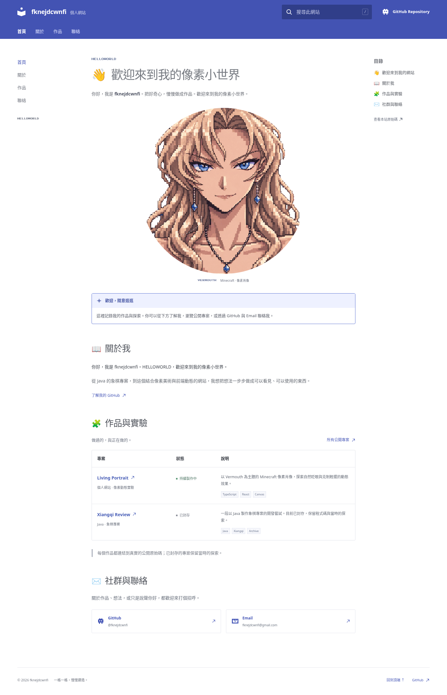

# fknejdcwnfi · 我的像素小世界

**HELLOWORLD**。fknejdcwnfi的個人網站，以穩定的Minecraft像素圓形肖像呈現Vermouth。

- [正式網站](https://fknejdcwnfi.github.io/website/) · [目前重構指南](docs/guides/calm-circle.md)
- [完整不可變原工程](reference-projects/fuji-wind/) · GitHub：<https://github.com/fknejdcwnfi> · Email：**fknejdcwnfi@gmail.com**

依最新回饋，已撤下令人不適的整圖變形、外景、雪層和舊影片。現在是無邊框圓形、透明背景、716×534像素人物，臉、身體、前景髮與珠寶固定；只有兩塊後側髮束克制輕擺、眼睑局部自然眨動。動態在rAF更新，減少動態／隱藏／離屏及失敗恢復保持。



[目前圓形畫面](artifacts/calm-circle/site/circle.png) · [克制動態預覽](artifacts/calm-circle/preview/animation.mp4) · [固定像素與整站檢查](artifacts/calm-circle/site/checks.json)

舊`scenic-snow`是被拒絕的歷史實作，不代表現在效果；原ZIP與所有原始圖片保留。新預設不下載那些整圖位移字段、圖集或影片，也不以全圖縮放／扭曲假裝飄髮。

## 開始開發

使用 `.nvmrc` 指定的 Node24：

```bash
npm ci
npm run dev
```

開發網址為 `/`；`npm run build` 後用 `npm run preview` 檢查 `/website/`。送出前執行：

```bash
npm test
npm run typecheck
npm run build
npm run assets:check
npm run assets:verify
```

任務PR通過檢查後自動合併至 `main`，GitHub Actions負責Pages發佈；擁有者已授權自動更新。`npm run deploy`保留為明確要求時的手動備援，不用它跳過PR流程。

## 改成我的內容

只需先編輯 [site.ts](src/features/profile/content/site.ts)，角色動畫與個人資料互相獨立：

```ts
name: 'fknejdcwnfi',
intro: 'HELLOWORLD',
email: 'fknejdcwnfi@gmail.com',
socials: [],       // 填入你已確認的公開B站／抖音等帳號
gameProfiles: [], // 填入你願意公開的王者荣耀／火影忍者等資料
```

`socials`支援平台、名稱、HTTPS公開網址及可選暱稱；`gameProfiles`支援遊戲、公開暱稱／ID、區服、說明及可選HTTPS連結。沒有資料時不顯示空卡片、遊戲導覽或無效按鈕。需要新增時，參考 [site.example.ts](src/features/profile/content/site.example.ts) 的四個型別工廠與[完整欄位說明](docs/guides/personal-site.md#帳號與遊戲擴充)，填入自己的真實資料；範例檔不由網站載入。

作品只列真實公開repo，`xiangqi-review`如實標為封存。聯絡使用Email／GitHub及設定完成的社群，不使用假送信表單。Press Start 2P字體自託管，附[SIL OFL](public/fonts/OFL.txt)，中文使用系統字體。

## 目錄

```text
src/
  app/                 頁面組合、全站錯誤邊界與基礎樣式
  authoring/           歷史來源轉製工具，不由runtime引用
  features/
    profile/           個人內容、網站版面、靜態HTML與像素UI
    referenceScene/    共用圓形UI／可見性播放器；舊source場景歷史
    calmPortrait/      現在預設：固定人物plate、後髮剛體與局部眼睑
    portrait/          歷史近景播放器，明確入口才載入
  shared/              共用動畫型別
  archive/             legacy／voxel歷史模式及舊field renderer對照
scripts/
  assets/              素材匯出與來源驗證
  qa/                  真實網站截幀、瀏覽器與效能檢查
  tests/               Node單元測試
  deploy/              手動部署備援
reference-projects/    使用者完整工程ZIP、原檔與來源校驗
assets/generated/      單一像素母版、局部眼瞼、完整景色與來源動作字段
public/assets/reference-scene/  歷史場景素材，不由現在首頁載入
public/assets/calm-circle/     現在的固定人物、兩側後髮、局部眼睑及來源清冊
docs/
  guides/              現行個人化、角色、動態、開發及素材指南
  archive/             已標示日期的舊階段文件
  reference/           原始委託與分鏡，凍結唯讀
  decisions.md         決策歷史
archive/runtime/       保留但不隨網站打包的舊runtime素材
archive/evidence/      原v2／v4／v5量測與影像歷史
```

`SiteShell`提供共享版面與內容插槽；未來真實功能可組合新區塊並更新靜態HTML，不需要修改髮束rig。詳細路徑見[開發指南](docs/guides/development.md)。

## 動態與驗證

目前預設在`src/features/calmPortrait/`，共用播放器和圓形UI仍位於`referenceScene/`。12秒小角度剛體後髮輕擺與24秒不等間隔局部眨眼分開，固定人物像素不參與任何變形；這是刻意克制的肖像，不宣稱大幅風動或完整毛髮模擬。

[最新指南](docs/guides/calm-circle.md)與`artifacts/calm-circle/`記錄當前圖層、穩定區域和整個固定plate的逐像素檢查。原GIF／舊sourceclock與PR16的無翻折數字不能證明新肖像自然，歷史路由只在明確選擇時載入。

## 素材

`assets/source/**`及`docs/reference/**`保持唯讀。新首頁權威是`reference-projects/fuji-wind/`完整原工程；歷史近景canonical母版仍在 `assets/generated/portrait-v4/`，局部髮後修復在 `assets/generated/portrait-wind/`，runtime為 `public/assets/portrait-natural/`。不輪播新生成的臉、不整張圖晃動，也不擴圖成完整胸像。[素材清冊](docs/guides/asset-inventory.md)記錄來源及限制。

貝爾摩德出自《名偵探柯南》，角色權利屬原權利方，本專案為個人非商業粉絲作品。Minecraft為相關權利方商標，本站不是官方合作產品。見[變更紀錄](CHANGELOG.md)。
