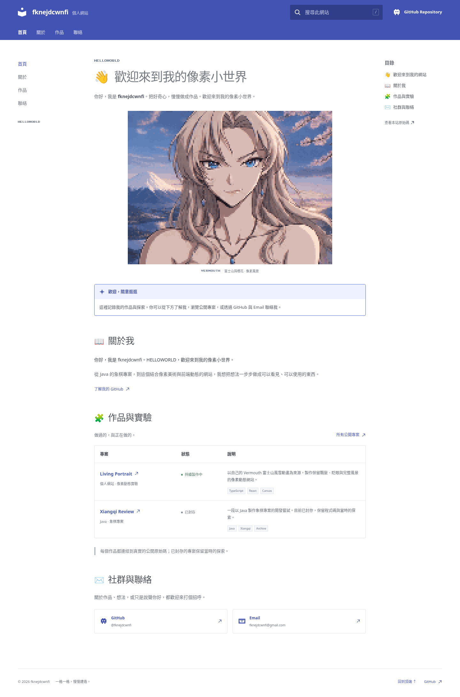

# fknejdcwnfi · 我的像素小世界

**HELLOWORLD**。這是 fknejdcwnfi 的個人網站，首頁是依使用者提供的富士山風雪GIF工程重構的全幅像素場景，保留原飄髮、眨眼、耳飾、富士山、櫻花與落日構圖。

- 網站：<https://fknejdcwnfi.github.io/website/>
- GitHub：<https://github.com/fknejdcwnfi> · Email：**fknejdcwnfi@gmail.com**
- [原始ZIP與全量工程](reference-projects/fuji-wind/) · [重構／復現指南](docs/guides/reference-gif-rebuild.md)

原GIF16幀、每幀80ms、周期1280ms；全幅轉為共享80色、160×120像素格，nearest整數放大。預設以128個運動補償樣本平滑播放，原16個像素錨幀保持逐像素一致，眼區保留原眨眼時序。中間影格是估計，不能宣稱原檔本來有100fps、像素化仍與原RGB完全相同或已實機驗證高刷。`?motion=original`提供原16幀節奏對照。

網站內容、搜尋、真實專案、聯絡和無JavaScript後備保留。預設不再使用舊圓形近景、獨立風表或獨立眨眼；歷史角色仍可用`?view=portrait`明確檢視，主頁不載入那些素材。



[手機](artifacts/reference-scene/site/mobile.png) · [動態預覽](artifacts/reference-scene/preview/animation.mp4) · [原始來源聯繫幀](artifacts/reference-scene/source-analysis/contact.png)

## 開始開發

使用 `.nvmrc` 指定的 Node24：

```bash
npm ci
npm run dev
```

開發網址為 `/`；`npm run build` 後用 `npm run preview` 檢查 `/website/`。送出前執行：

```bash
npm test
npm run typecheck
npm run build
npm run assets:check
npm run assets:verify
```

任務PR通過檢查後自動合併至 `main`，GitHub Actions負責Pages發佈；擁有者已授權自動更新。`npm run deploy`保留為明確要求時的手動備援，不用它跳過PR流程。

## 改成我的內容

只需先編輯 [site.ts](src/features/profile/content/site.ts)，角色動畫與個人資料互相獨立：

```ts
name: 'fknejdcwnfi',
intro: 'HELLOWORLD',
email: 'fknejdcwnfi@gmail.com',
socials: [],       // 填入你已確認的公開B站／抖音等帳號
gameProfiles: [], // 填入你願意公開的王者荣耀／火影忍者等資料
```

`socials`支援平台、名稱、HTTPS公開網址及可選暱稱；`gameProfiles`支援遊戲、公開暱稱／ID、區服、說明及可選HTTPS連結。沒有資料時不顯示空卡片、遊戲導覽或無效按鈕。需要新增時，參考 [site.example.ts](src/features/profile/content/site.example.ts) 的四個型別工廠與[完整欄位說明](docs/guides/personal-site.md#帳號與遊戲擴充)，填入自己的真實資料；範例檔不由網站載入。

作品只列真實公開repo，`xiangqi-review`如實標為封存。聯絡使用Email／GitHub及設定完成的社群，不使用假送信表單。Press Start 2P字體自託管，附[SIL OFL](public/fonts/OFL.txt)，中文使用系統字體。

## 目錄

```text
src/
  app/                 頁面組合、全站錯誤邊界與基礎樣式
  features/
    profile/           個人內容、網站版面、靜態HTML與像素UI
    referenceScene/    預設全幅像素場景、原GIF時鐘、圖集與生命週期
    portrait/          歷史近景播放器，明確入口才載入
  shared/              共用動畫型別
  archive/             legacy／voxel歷史模式及舊field renderer對照
scripts/
  assets/              素材匯出與來源驗證
  qa/                  真實網站截幀、瀏覽器與效能檢查
  tests/               Node單元測試
  deploy/              手動部署備援
reference-projects/    使用者完整工程ZIP、原檔與來源校驗
public/assets/reference-scene/  共享調色盤的源／平滑圖集與後備首幀
docs/
  guides/              現行個人化、角色、動態、開發及素材指南
  archive/             已標示日期的舊階段文件
  reference/           原始委託與分鏡，凍結唯讀
  decisions.md         決策歷史
archive/runtime/       保留但不隨網站打包的舊runtime素材
archive/evidence/      原v2／v4／v5量測與影像歷史
```

`SiteShell`提供共享版面與內容插槽；未來真實功能可組合新區塊並更新靜態HTML，不需要修改髮束rig。詳細路徑見[開發指南](docs/guides/development.md)。

## 動態與驗證

正常首頁在可見時持續風動，12秒中包含兩段影片尺度的六秒風勢／回落短語。眨眼仍是已認可的24秒獨立時鐘，三次事件相隔6.9–9秒，每次280ms。沒有公開播放／暫停按鈕；隱藏／離屏停止繪製並保留相位。減少動態、pose1／10、wind0／direction0直接畫原canonical且不啟動Worker；wind0仍可眨眼，恢復風動才準備物理緩存。`?view=portrait&debug=1`保留開發控制。

初始HTML、透明poster、素材逾時與錯誤邊界保留無JS或故障時的完整網站。Worker準備不阻塞操作，失敗使用獨立靜態肖像；設定切換與destroy使用世代檢查，防止過期結果或錯誤破壞新狀態。網站的藍色雙層導航、搜索、真實個人內容及帳號擴充設定保持。

[目前重建指南](docs/guides/video-layered-rebuild.md)與 `artifacts/video-layered/` 記錄實際材料、物理、網格、固定五官、投影裁剪、生命週期、全站備援與production效能。像素變化量或測試項數不能單獨證明像影片；實際關鍵幀與完整動畫一同保留。

實際顯示更新率受瀏覽器、OS、裝置與螢幕限制；240Hz求解、120Hz姿態緩存、GIF編碼率及不限幀容器吞吐都不等於實機顯示FPS。這是二維髮帶約束模型，並非三維逐根毛髮或完整流體模擬。證據不隨網站runtime下載。

## 素材

`assets/source/**`及`docs/reference/**`保持唯讀。原始參考是身份與近景構圖的最高權威；canonical母版仍在 `assets/generated/portrait-v4/`，局部髮後修復在 `assets/generated/portrait-wind/`，runtime為 `public/assets/portrait-natural/`。不輪播新生成的臉、不整張圖晃動，也不擴圖成完整胸像。[素材清冊](docs/guides/asset-inventory.md)記錄來源及限制。

貝爾摩德出自《名偵探柯南》，角色權利屬原權利方，本專案為個人非商業粉絲作品。Minecraft為相關權利方商標，本站不是官方合作產品。見[變更紀錄](CHANGELOG.md)。
