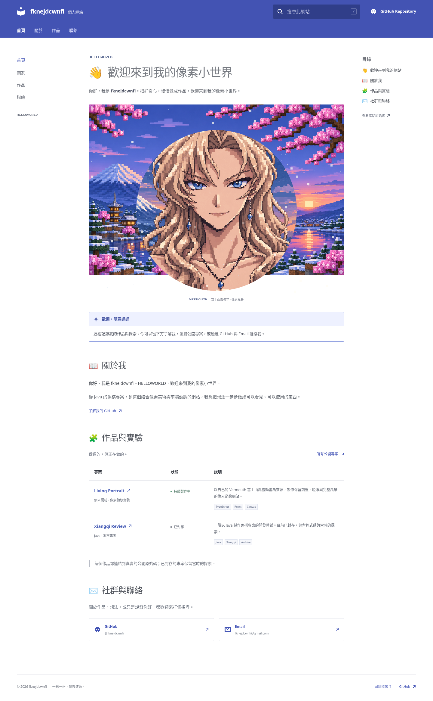

# fknejdcwnfi · 我的像素小世界

**HELLOWORLD**。這是fknejdcwnfi的個人網站，以Minecraft-inspired二維像素美術呈現Vermouth、富士山、樱花、雪與夕陽。

- [正式網站](https://fknejdcwnfi.github.io/website/) · [GitHub](https://github.com/fknejdcwnfi) · Email：**fknejdcwnfi@gmail.com**
- [最新工程與重跑指南](docs/guides/minecraft-scenic-rebuild.md) · [完整不可變原工程](reference-projects/fuji-wind/)

整幅美術已重新繪製，不再以原動畫放大當作Minecraft效果。單一像素母版保留角色特徵，以源16姿態驅動飄發及局部眨眼；高清輸出716×534，完整1536×1024方塊富士山／樱花／雪林／夕陽景色延展至無邊圓形人物外側。216片分層像素雪從首幀開始動態。

初始HTML先播放約929KiB的progressive影片，React保留同一video節點，無損圖集依當前相位接手；沒有等待完整圖集的人工延遲。原16×80ms／1280ms節奏和160×8ms估計樣本保留，影片也為125fps／160張；編碼或樣本率不等於實體顯示器FPS。新RGB和遮擋形變不是原GIF逐像素相同，原ZIP／原圖全部保持不變。



[手機](artifacts/scenic-snow/site/mobile.png) · [完整動態預覽](artifacts/scenic-snow/preview/animation.mp4) · [首屏動態驗證](artifacts/scenic-snow/progressive-start.json) · [美術母版](assets/generated/minecraft-style/style-master.png)

## 開始開發

使用 `.nvmrc` 指定的 Node24：

```bash
npm ci
npm run dev
```

開發網址為 `/`；`npm run build` 後用 `npm run preview` 檢查 `/website/`。送出前執行：

```bash
npm test
npm run typecheck
npm run build
npm run assets:check
npm run assets:verify
```

任務PR通過檢查後自動合併至 `main`，GitHub Actions負責Pages發佈；擁有者已授權自動更新。`npm run deploy`保留為明確要求時的手動備援，不用它跳過PR流程。

## 改成我的內容

只需先編輯 [site.ts](src/features/profile/content/site.ts)，角色動畫與個人資料互相獨立：

```ts
name: 'fknejdcwnfi',
intro: 'HELLOWORLD',
email: 'fknejdcwnfi@gmail.com',
socials: [],       // 填入你已確認的公開B站／抖音等帳號
gameProfiles: [], // 填入你願意公開的王者荣耀／火影忍者等資料
```

`socials`支援平台、名稱、HTTPS公開網址及可選暱稱；`gameProfiles`支援遊戲、公開暱稱／ID、區服、說明及可選HTTPS連結。沒有資料時不顯示空卡片、遊戲導覽或無效按鈕。需要新增時，參考 [site.example.ts](src/features/profile/content/site.example.ts) 的四個型別工廠與[完整欄位說明](docs/guides/personal-site.md#帳號與遊戲擴充)，填入自己的真實資料；範例檔不由網站載入。

作品只列真實公開repo，`xiangqi-review`如實標為封存。聯絡使用Email／GitHub及設定完成的社群，不使用假送信表單。Press Start 2P字體自託管，附[SIL OFL](public/fonts/OFL.txt)，中文使用系統字體。

## 目錄

```text
src/
  app/                 頁面組合、全站錯誤邊界與基礎樣式
  authoring/           歷史來源轉製工具，不由runtime引用
  features/
    profile/           個人內容、網站版面、靜態HTML與像素UI
    referenceScene/    Minecraft圓形人物／全景／飄雪／首屏影片與源時鐘
    portrait/          歷史近景播放器，明確入口才載入
  shared/              共用動畫型別
  archive/             legacy／voxel歷史模式及舊field renderer對照
scripts/
  assets/              素材匯出與來源驗證
  qa/                  真實網站截幀、瀏覽器與效能檢查
  tests/               Node單元測試
  deploy/              手動部署備援
reference-projects/    使用者完整工程ZIP、原檔與來源校驗
assets/generated/      單一像素母版、局部眼瞼、完整景色與來源動作字段
public/assets/reference-scene/  MC圖集、HD首幀、progressive影片、完整背景與清冊
docs/
  guides/              現行個人化、角色、動態、開發及素材指南
  archive/             已標示日期的舊階段文件
  reference/           原始委託與分鏡，凍結唯讀
  decisions.md         決策歷史
archive/runtime/       保留但不隨網站打包的舊runtime素材
archive/evidence/      原v2／v4／v5量測與影像歷史
```

`SiteShell`提供共享版面與內容插槽；未來真實功能可組合新區塊並更新靜態HTML，不需要修改髮束rig。詳細路徑見[開發指南](docs/guides/development.md)。

## 動態與驗證

預設使用單一Minecraft美術母版的來源姿態重定向，保留原1280ms周期和160個8ms估計樣本。源時鐘與32秒雪景時鐘分開，沒有逐幀生成新臉。隱藏／離屏停止繪製並保留相位，減少動態不下載video／圖集。`?view=scene`可隔離觀看，`?t=560`檢查源時刻，`?motion=original`對照16個新美術源錨幀。舊肖像僅由明確歷史路由lazy載入。

[最新指南](docs/guides/minecraft-scenic-rebuild.md)與`artifacts/scenic-snow/`保存本輪來源／新美術區分、無翻折字段、同相位媒體接手、真實全景截幀及performance。原像素資料保留不等於新美術和原RGB一致；位移估計、遮擋和隱藏髮層仍有限制。前版原畫風的像素檢查在`artifacts/crisp-circle/`，不替代新Minecraft美術證據。

## 素材

`assets/source/**`及`docs/reference/**`保持唯讀。新首頁權威是`reference-projects/fuji-wind/`完整原工程；歷史近景canonical母版仍在 `assets/generated/portrait-v4/`，局部髮後修復在 `assets/generated/portrait-wind/`，runtime為 `public/assets/portrait-natural/`。不輪播新生成的臉、不整張圖晃動，也不擴圖成完整胸像。[素材清冊](docs/guides/asset-inventory.md)記錄來源及限制。

貝爾摩德出自《名偵探柯南》，角色權利屬原權利方，本專案為個人非商業粉絲作品。Minecraft為相關權利方商標，本站不是官方合作產品。見[變更紀錄](CHANGELOG.md)。
