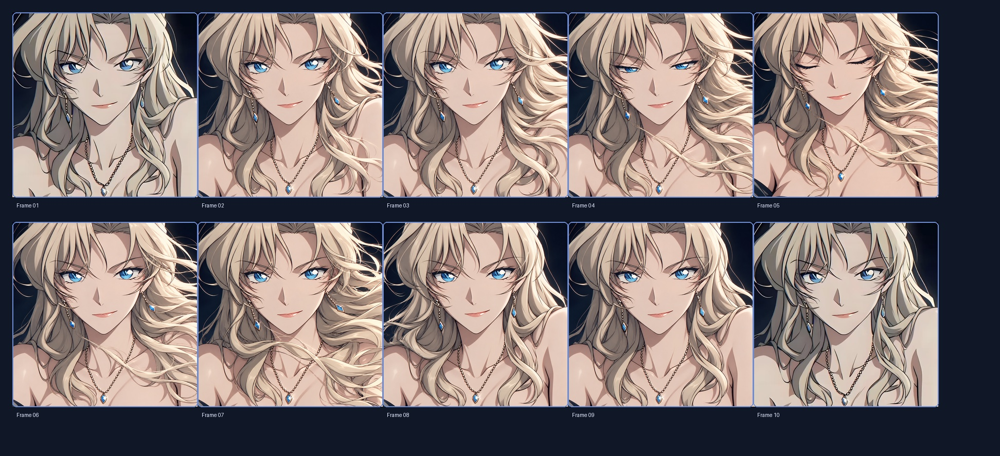
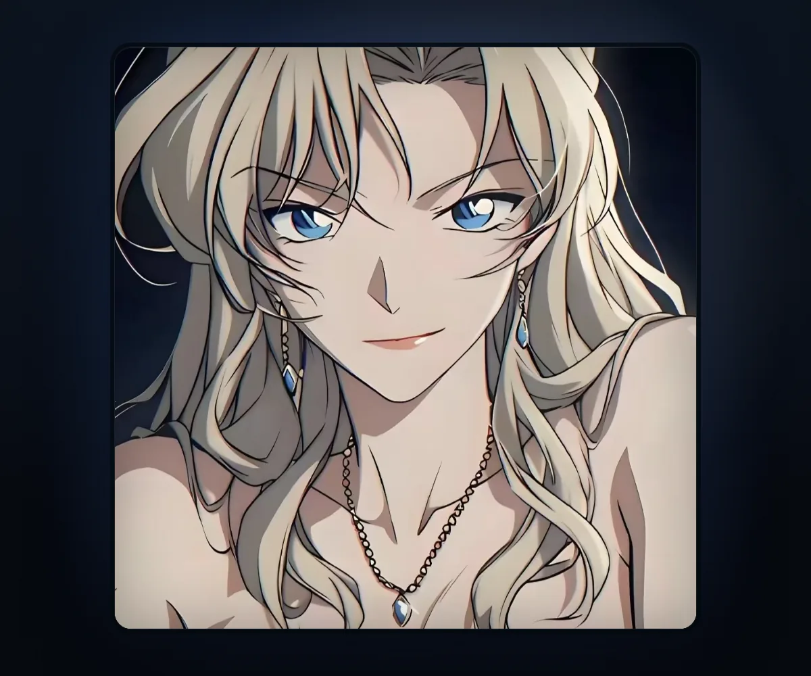
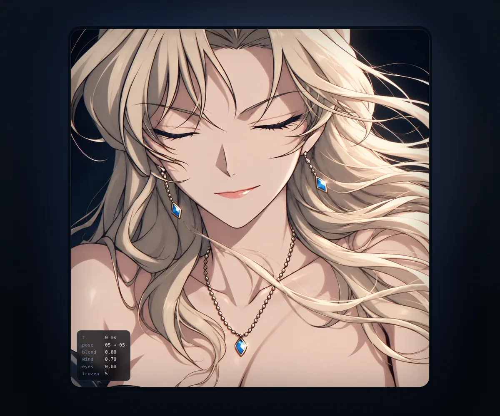

# Vermouth · Character Stage

一個「只有角色」的正方形動畫舞台：白金色長髮隨風流動、一次自然的眨眼，然後回到靜止。
這是我個人網站的第一個公開版本，也是後續角色動畫系統的可部署底座。



- **線上網址**：<https://fknejdcwnfi.github.io/website/>（`gh-pages` 分支）
- **技術底座**：Vite 8 + React 19 + TypeScript 7 + Canvas 2D
- **目前版本**：`0.1.0`（Stage 1：關鍵姿態預覽，尚未完成分層綁定）

---

## 這是什麼

這個專案不是一個功能繁多的入口網站，而是一個視覺作品式的個人頁面：

- 畫面是 1:1 正方形，構圖與原始角色圖一致。
- 畫面中只有角色，沒有導航、按鈕、文字或社群連結。
- 角色的頭髮、眨眼與飾物以時間軸驅動，循環播放。
- 尊重 `prefers-reduced-motion`：使用者要求減少動態時，只顯示靜止的第 1 幀。
- 部署在 GitHub Pages；執行 `npm run deploy` 會建置並發佈到 `gh-pages` 分支。

> [!IMPORTANT]
> 目前版本是 **Stage 1：Key-Pose Preview**。
> 它把十張 AI 生成的關鍵姿態以短暫交叉淡入播放，用來驗證舞台、時間軸、部署與視覺方向。
> 它**不是**最終的無縫角色動畫；交叉淡入在髮絲與臉部邊緣可能出現輕微殘影。
> 真正的交付標準是「固定原圖 + 分層變形」的 rig，詳見 [動畫規格](docs/03-animation-spec.md) 與 [目標架構](docs/04-architecture.md)。

### 目前畫面

| 桌面（1200×1000） | 手機（390×844，DPR 2） |
| --- | --- |
|  |  |

除錯模式（`?pose=5&debug=1`，凍結在閉眼幀）：



---

## 快速開始

需求：Node.js **22.12+**（本專案以 24 開發，見 `.nvmrc`）。

```bash
nvm use            # 若你使用 nvm
npm install
npm run dev        # http://localhost:5173/
```

其他指令：

| 指令 | 作用 |
| --- | --- |
| `npm run dev` | 啟動開發伺服器（base `/`） |
| `npm run build` | 型別檢查 + 產出 `dist/`（production base `/website/`） |
| `npm run preview` | 預覽 production build（<http://localhost:4173/website/>） |
| `npm run typecheck` | 只跑 `tsc --noEmit` |
| `npm run deploy` | 建置並把 `dist/` 發佈到 `gh-pages` 分支 |
| `npm run assets` | 從原始素材重新產生 WebP 衍生檔（需 Python 3 + Pillow） |
| `npm run assets:check` | 檢查衍生檔是否齊全 |

除錯參數（不影響一般訪客）：

| URL | 作用 |
| --- | --- |
| `?debug=1` | 顯示時間、姿態、混合權重、風力與眼睛開合狀態 |
| `?pose=1`～`?pose=10` | 凍結在指定關鍵姿態，方便逐幀比對 |
| `?debug=1&pose=5` | 兩者合用，檢查閉眼幀與數值 |

---

## 專案結構

```text
.
├── assets/source/              # 原始素材（不可修改、不可覆寫）
│   ├── frames/frame_01..10.png # 十張關鍵姿態，1080²（04/05 為 1254²）
│   ├── original_reference.jpg  # 角色原始參考圖
│   └── preview/                # 聯絡表與預覽 GIF
├── public/                     # 直接輸出的靜態資源
│   ├── assets/frames/*.webp    # 由 scripts/optimize_assets.py 產生
│   ├── assets/manifest.json    # 衍生檔尺寸、位元組數、SHA-256
│   ├── og-image.webp           # 社交分享圖
│   └── favicon.svg             # 藍寶石墜飾圖示
├── src/
│   ├── animation/
│   │   ├── keyPoses.ts         # 十幀時間軸（時間、風力、眼睛開合）
│   │   └── player.ts           # rAF + delta 驅動的 Canvas 播放器
│   ├── components/
│   │   └── CharacterStage.tsx  # 舞台元件、除錯 HUD、減少動態偏好
│   ├── App.tsx
│   ├── main.tsx
│   └── styles.css
├── scripts/
│   ├── optimize_assets.py      # 可重現的素材管線
│   └── deploy_gh_pages.sh      # 建置並發佈到 gh-pages 分支
├── deploy/github-actions/      # 可選的 Actions workflow（需 workflow scope）
├── docs/                       # 規格、架構、開發與 Codex 交接文件
├── index.html
├── vite.config.ts
└── package.json
```

---

## 文件導覽

請依照目的閱讀；第一次接觸本專案，建議按編號順序。

| 文件 | 內容 | 讀者 |
| --- | --- | --- |
| [docs/README.md](docs/README.md) | 閱讀指南、文件優先級、用語約定 | 所有人 |
| [01 專案章程](docs/01-project-charter.md) | 定位、目標、非目標、分期與成功標準 | 專案擁有者、Codex |
| [02 素材清冊](docs/02-asset-inventory.md) | 素材來源、尺寸、雜湊、已知瑕疵與管線 | 美術、前端 |
| [03 動畫規格](docs/03-animation-spec.md) | 時間軸、髮絲與眨眼模型、驗收測試 | 動畫、前端、QA |
| [04 目標架構](docs/04-architecture.md) | 現況架構與分層 rig 的設計藍圖 | 前端、Codex |
| [05 開發指南](docs/05-development.md) | 環境、指令、部署、疑難排解 | 開發者 |
| [06 Codex 交接](docs/06-codex-handoff.md) | 雲端協作規則、工作順序、可直接貼上的提示詞 | Codex Cloud、擁有者 |
| [07 QA 檢查表](docs/07-qa-checklist.md) | 發佈前逐項檢查 | QA、Codex |
| [08 決策紀錄](docs/08-decisions.md) | ADR：為何是 Vite、Canvas、Pages | 所有人 |
| [參考原文](docs/reference/) | 最初的分鏡 prompt 與 Codex 任務書（保留原樣） | 所有人 |

---

## 素材管線

原始 PNG 是唯一真實來源，永遠不修改；網站只載入由腳本產生的 WebP。

```bash
python3 -m pip install Pillow   # 只需一次
npm run assets                  # 重新產生 public/assets/frames/*.webp
npm run assets:check            # CI/本機檢查衍生檔是否存在
```

管線行為：

- 將每幀縮放至長邊 1080 px（04/05 由 1254 px 縮小），保持 1:1。
- 以 WebP quality 86、method 6 輸出，十幀合計約 1.4 MB。
- 產生 `public/assets/manifest.json`，內含每幀的尺寸、位元組數與 SHA-256。
- 由 `original_reference.jpg` 產生 1200×630 的 `og-image.webp`。
- 若輸入不是正方形，腳本會直接失敗，避免默默產生變形素材。

素材的權利與限制請見 [素材清冊](docs/02-asset-inventory.md#權利與使用範圍)。

---

## 部署到 GitHub Pages

目前使用 **`gh-pages` 分支**部署，不需要 GitHub Actions 的 `workflow` scope：

```bash
npm run deploy
```

這個指令會：

1. 執行 `npm run build`（production base 為 `/website/`）。
2. 把 `dist/` 內容放進暫存目錄，加上 `.nojekyll`。
3. 建立／更新 `gh-pages` 分支並強制推送。
4. GitHub Pages 從 `gh-pages` 分支的根目錄提供網站。

一次性 Pages 設定（已由建置者完成）：

1. GitHub → **Settings → Pages**。
2. **Build and deployment → Source** 選擇 **Deploy from a branch**。
3. Branch 選 **`gh-pages`**，資料夾選 **`/ (root)`**。
4. 網址：<https://fknejdcwnfi.github.io/website/>

### 選用：GitHub Actions

若你之後為 token 加上 `workflow` scope，可改用自動部署：

- 預備的 workflow 在 [`deploy/github-actions/`](deploy/github-actions/)。
- 啟用步驟見該目錄的 README。
- 啟用後把 Pages Source 改為 **GitHub Actions**，避免兩種機制互相覆蓋。

production build 的 `base` 預設為 `/website/`，與倉庫名稱一致。
若改用自訂網域或根路徑部署：

```bash
VITE_BASE=/ npm run build
```

其他部署細節與替代平台見 [開發指南](docs/05-development.md#部署)。

---

## 給 Codex Cloud 的入口

在 Codex Cloud 連接此倉庫後，請先讓它讀：

1. [`docs/06-codex-handoff.md`](docs/06-codex-handoff.md)
2. [`docs/01-project-charter.md`](docs/01-project-charter.md)
3. [`docs/03-animation-spec.md`](docs/03-animation-spec.md)
4. [`docs/04-architecture.md`](docs/04-architecture.md)

三條不可妥協的規則：

- `assets/source/**` 唯讀；任何生成物放到 `assets/generated/` 或 `public/assets/rig/`。
- 不得把十張不一致的圖直接輪播並宣稱是無縫動畫。
- 不得改成 pixel art、Minecraft、3D 或重新設計角色。

---

## 已知限制

- **身份一致性**：十幀由獨立生成而來，臉部幾何、髮絲走向與飾物位置有細微差異；交叉淡入時可能出現殘影。
- **解析度不一致**：第 04、05 幀是 1254×1254，其餘為 1080×1080；衍生檔已統一縮放，但構圖仍有極小偏移。
- **尚未分層**：目前沒有頭髮、眼皮、耳環的獨立圖層，因此無法做真正的局部變形。
- **沒有自動化視覺測試**：目前以 `npm run build`、`?pose=` 凍結比對與人工檢查為主。
- **角色僅有一位**：舞臺是為單一角色設計的，尚未抽象成多角色系統（也不在近期範圍）。

---

## 權利與致謝

- 角色「貝爾摩德（Vermouth）」出自《名偵探柯南》，原作權利屬於青山剛昌與相關權利方。
- 本倉庫中的圖像為個人、非商業性質的粉絲創作／AI 輔助素材，僅供個人網站展示。
- 本倉庫不附帶任何再授權；請勿將角色圖像用於商業用途、再散布或訓練用途。
- 程式碼架構與文件由本專案維護；若未來加入第三方字型、材質或函式庫，需在 [素材清冊](docs/02-asset-inventory.md) 補上來源與授權。

---

## 版本

目前為 `0.1.0`。變更紀錄見 [CHANGELOG.md](CHANGELOG.md)。