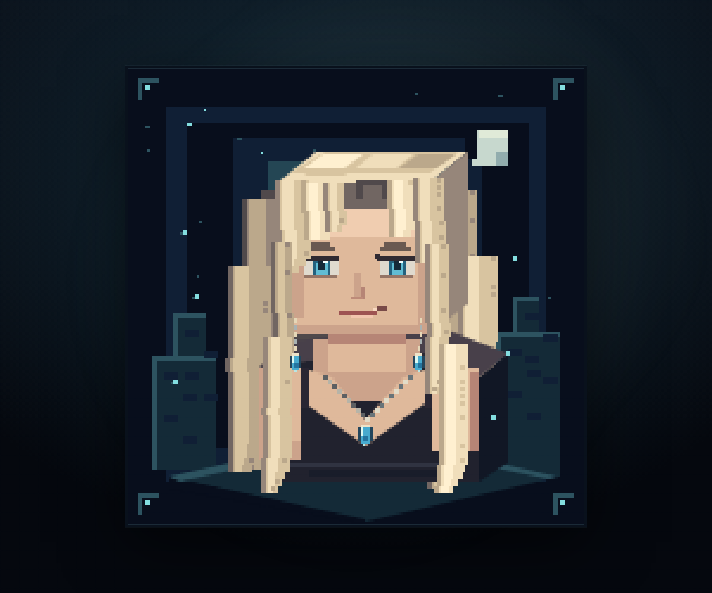
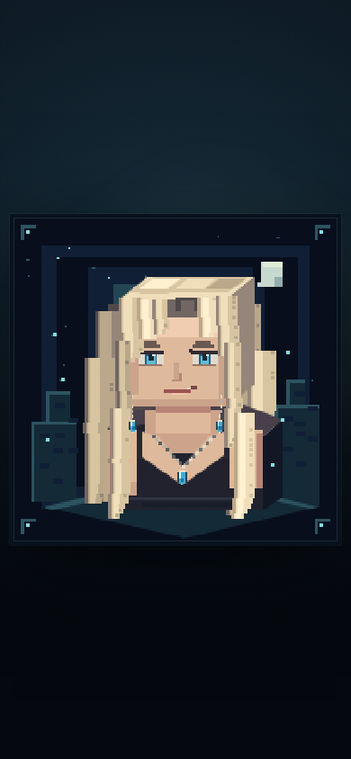

# Vermouth · Pixel Stage

Minecraft 風格的像素動態 Vermouth 個人網站：白金長髮、藍眼與藍色飾物，以方塊造型、獨立髮束、局部眨眼及耳環動態呈現。頁面維持單一角色舞台，沒有常駐導航、按鈕或社群圖示。

- **網站**：<https://fknejdcwnfi.github.io/website/>
- **技術**：Vite 8 + React 19 + TypeScript 7 + Native Canvas 2D
- **目前契約**：[Minecraft 風格像素舞台](docs/10-pixel-stage.md)
- **舊版**：網址加入 `?style=legacy` 可看原 anime 關鍵姿態預覽；它仍是 provisional，不是已完成的分層 rig。

擁有者於 2026-10-28 明確將方向改為「我的世界／Minecraft 的像素動態 Vermouth」，取代舊版禁止像素風的規格。這是風格化網站作品，不是 Minecraft 遊戲或官方 skin，也不宣稱逐像素複製原圖或已達所有裝置的完美品質。

| 桌機舞台 | 手機舞台 |
| --- | --- |
|  |  |

以上是實際 renderer 的靜態截圖；分享圖使用同一程序化角色的 [768² 像素圖](public/og-pixel.png)，未修改原始角色圖。

## 開發

建置與測試使用 `.nvmrc` 指定的 Node 24。`npm run build` 的 `prebuild` 會先執行 `npm test`，以 Node 24 的內建 TypeScript type stripping 檢查控制參數與時間軸；沒有新增測試框架依賴。

```bash
nvm use            # 使用 nvm 時
npm ci
npm run dev
```

production 預覽：

```bash
npm run build
npm run preview
# 在本機檢查 /website/；開發模式路徑則為 /
```

預設像素舞台的邏輯畫布為 192×192，nearest-neighbor 放大。角色、背景與局部動態由程式繪製，不載入十張 PNG／WebP 作預設動畫，不需額外 renderer、字型、CDN、後端或帳號。主循環為 4800 ms，局部眨眼窗口 220 ms，繪製率上限 24 fps。減少動態偏好會停止角色與背景動態；指定姿態亦保持靜止。

## 個人化與除錯

網址參數保留個人化空間，不需要改原始素材：

| 參數 | 可用值 | 效果 |
| --- | --- | --- |
| `theme` | `midnight`、`emerald`、`amethyst` | 午夜藍、翡翠、紫水晶舞台 |
| `wind` | 0–1，預設 0.65 | 髮束風力 |
| `speed` | 0.25–2，預設 1 | 動畫速度 |
| `seed` | uint32，預設 7 | 可重現的像素背景配置 |
| `pose` | 整數 1–10 | 凍結姿態，1／10 相同 |
| `debug` | `1` | 顯示除錯資訊 |
| `style` | `voxel`（預設）、`legacy` | 新像素舞台／舊原圖預覽 |

```text
?theme=emerald&wind=0.35&speed=0.75&seed=42
?theme=amethyst&debug=1&pose=5
?style=legacy&pose=5
```

未來仍可獨立調整配色、動態參數、像素造型、分享 metadata 與網站內容外殼。新增名字、作品集或社群入口時，再按使用者實際內容更新設計與可及性；不在這次預填個資或新增空白控制項。詳細邊界見 [目前契約](docs/10-pixel-stage.md)。

## 檢查與部署

```bash
npm test
npm run typecheck
npm run build
npm run assets:check
npm run assets:verify
```

`assets:verify` 驗證保留的十張 legacy 衍生圖、manifest、來源 01／10 相同，以及新 `og-pixel.png`／舊 `og-image.webp` 等必要靜態檔；它不代替新像素角色的瀏覽器驗收。桌機／手機、凍結、減少動態、循環與各主題的檢查要求見 [新 QA 契約](docs/10-pixel-stage.md#5-必需驗證)。

必要 CI 與相關驗證通過後自動合併 PR，`main` 由 GitHub Actions 發佈到 Pages，再確認該提交部署結果。`npm run deploy` 是會 force push `gh-pages` 的手動備援，仍須擁有者明確要求；日常更新不用它。

## 素材與文件

`assets/source/**` 與 `docs/reference/**` 保持唯讀。像素角色參考原圖的白金髮、藍眼、服裝與飾物辨識特徵，沒有覆寫、重新編碼或重生來源臉部。原始十幀、WebP 與 OG 圖保留，舊版幀間身份差異也沒有被新 renderer 冒稱修復。

先讀 [目前像素舞台契約](docs/10-pixel-stage.md)，再依 [文件導覽](docs/README.md) 與 [AGENTS.md](AGENTS.md) 開發。[P1 圖層計畫](docs/09-layer-plan.md) 為舊 anime 路線研究，[ADR](docs/08-decisions.md) 保留歷史及新的風格決策；變更紀錄見 [CHANGELOG](CHANGELOG.md)。

角色貝爾摩德（Vermouth）出自《名偵探柯南》，相關權利屬於原權利方；本專案為個人非商業粉絲作品，不附帶角色再授權。Minecraft 是相關權利方的商標，此網站並非官方合作產品。素材限制見 [清冊](docs/02-asset-inventory.md)。
